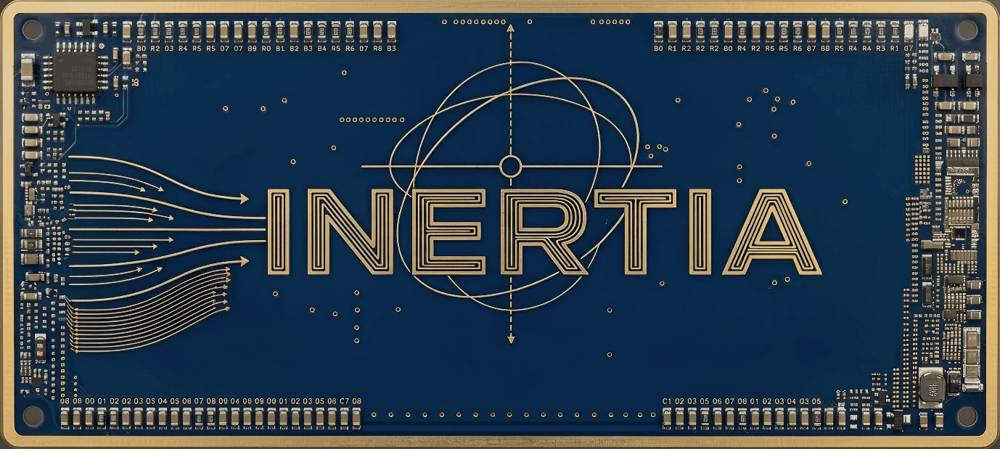

# Inertia



Modular embedded C++ library for motion-oriented, robotics-oriented, and device-control systems. It provides reusable models, hardware drivers, storage backends, control components, assemblies, logging, and task instrumentation for resource-constrained applications.

> Inertia is an actively developed, pre-1.0 library. APIs are usable today, but module boundaries and interfaces may continue to evolve as the framework expands.

## What Inertia provides

- Hardware-independent models and reusable components
- Platform-specific drivers for embedded peripherals and sensors
- Motion, orientation, kinematics, and control building blocks
- Persistent storage, journaling, calibration, and boot-state support
- Logging, task profiling, and instrumentation hooks
- Higher-level assemblies for robotics and vehicle-oriented systems

## Feature areas

### Motion, sensing, and estimation

- AHRS integrations, including Xio Fusion- and Reefwing-oriented components
- IMU support for LSM6DS3, QMI8658, and MPU6050 devices
- Optical-flow and range sensing for MTF-01/02 devices
- Kinematic models, velocity estimation, altitude estimation, and calibration flows
- ADC models and platform drivers

### Hardware interfaces and communication

- Serial/UART, I2C, and SPI abstractions
- UART device and stream support, including VG6328A helpers
- Link and transport-oriented models
- Lifecycle, data-source, observable, timestamp, and surface primitives

### Storage and persistence

- FRAM support
- LittleFS-backed file storage and repositories
- Append-only flash journaling with asynchronous queue support
- STM32 Maple-compatible internal flash support
- Persistent repositories for logs, boot counters, PWM calibration, and servo calibration

### Control and actuation

- PID and control-theory models
- Power-train and TB6612FNG H-bridge support
- Servo and PWM actuator models
- Calibrated actuator drivers and persistence helpers
- LED and addressable-strip models and drivers for WS2812B and SK6812 devices

### Logging and observability

- Log models, buffering, and repository drivers
- Sampling profiler components
- Platform sampling timers for AVR, STM32, and Raspberry Pi Pico
- Task instrumentation hooks for task IDs, debugging, status requests, and profiling

## Repository layout

- `src/InertiaModel.h` — Umbrella include for shared models, components, and assemblies
- `src/InertiaDrivers.h` — Umbrella include for concrete hardware and platform drivers
- `src/InertiaTaskInstrumentation.h` — Task instrumentation configuration helpers
- `src/Components` — Hardware-independent models and reusable building blocks
- `src/Drivers` — Hardware-specific and platform-specific implementations
- `src/Assemblies` — Higher-level systems composed from components and drivers
- `Examples` — Profiling, testing, and integration examples
- `media` — Project artwork and README media


## Public include points

For the framework’s hardware-independent models and reusable components:

```cpp
#include <InertiaModel.h>
```

For concrete hardware and platform integrations:

```cpp
#include <InertiaDrivers.h>
```

For task profiling and instrumentation, include this before using `TS::Task`:

```cpp
#include <InertiaTaskInstrumentation.h>
```

## Installation

Inertia is structured as an Arduino-compatible library. Add the repository to your Arduino libraries directory.

The library can also be included in other embedded C/C++ build systems by adding `src` to the compiler include path and selecting the drivers required by the target.

## Dependencies

Inertia depends on the following libraries:

| Dependency | Purpose |
|---|---|
| [`IntegerSignal`](https://github.com/GitMoDu/IntegerSignal) | Integer-based signal and feature representations used by Inertia components |
| [`Fletcher`](https://github.com/RobTillaart/Fletcher) | Fletcher checksum support, including Fletcher32 integrity checks used by the flash journal |
| [`EmbeddedStorage`](https://github.com/GitMoDu/EmbeddedStorage) | CRC-checked AVR EEPROM storage and optional EEPROM wear leveling |
| [`CRC`](https://github.com/RobTillaart/CRC) | CRC8 dependency required by EmbeddedStorage |
| [`TaskScheduler`](https://github.com/arkhipenko/TaskScheduler) | Cooperative task scheduling through `TS::Task` and `TS::Scheduler` |

Install these libraries alongside Inertia when using the corresponding components. The EEPROM driver is available on AVR ATmega328P and ATtiny85 targets and requires both `EmbeddedStorage` and `CRC`. `TaskScheduler` is required by Inertia’s task-based components, including lifecycle tasks, buffered logging, timestamp services, asynchronous flash journaling, UART watchdogs, and task profiling.

Platform-specific features may also require the corresponding Arduino core, filesystem implementation, timer support, or peripheral library for the selected target. Not every Inertia driver requires every platform dependency.

## AVR EEPROM storage

`Inertia::Drivers::Storage::Eeprom::StructStore<TData, Version, BaseAddress>` wraps EmbeddedStorage's synchronous CRC-checked `StorageUnit`. `Read` updates its output only when the stored CRC is valid; `Write` synchronously writes the record and verifies it by reading it back. Records must be trivially copyable. `Version` contributes to the default CRC key, so changing it invalidates data written with the previous version; the version is not stored as a separate field. For cooperative writes, use `AsyncStructStore` explicitly; it selects EmbeddedStorage's async storage-unit variants and owns the additional record buffer and polling state.

Include `<InertiaDrivers.h>` to use the backend.

The optional wear-level parameters select the corresponding EmbeddedStorage unit, for example:

```cpp
using SettingsStore = Inertia::Drivers::Storage::Eeprom::StructStore<
	Settings, 2, 64, WearLevelTiny, WearLevelTiny::x4>;
```

`BaseAddress` and the full footprint reported by `UsedSize` must not overlap other EEPROM allocations. The driver checks that the selected unit fits the target EEPROM at compile time. The EmbeddedStorage backend currently supports AVR ATmega328P and ATtiny85 targets. CRC detects accidental corruption; it is not cryptographic authentication.

## Compatibility

Inertia is designed for embedded targets and keeps platform-specific functionality in the driver layer. Individual components and drivers may depend on the selected MCU, framework, filesystem, task library, or peripheral implementation.

## License

Inertia is released under the [MIT License](LICENSE).
